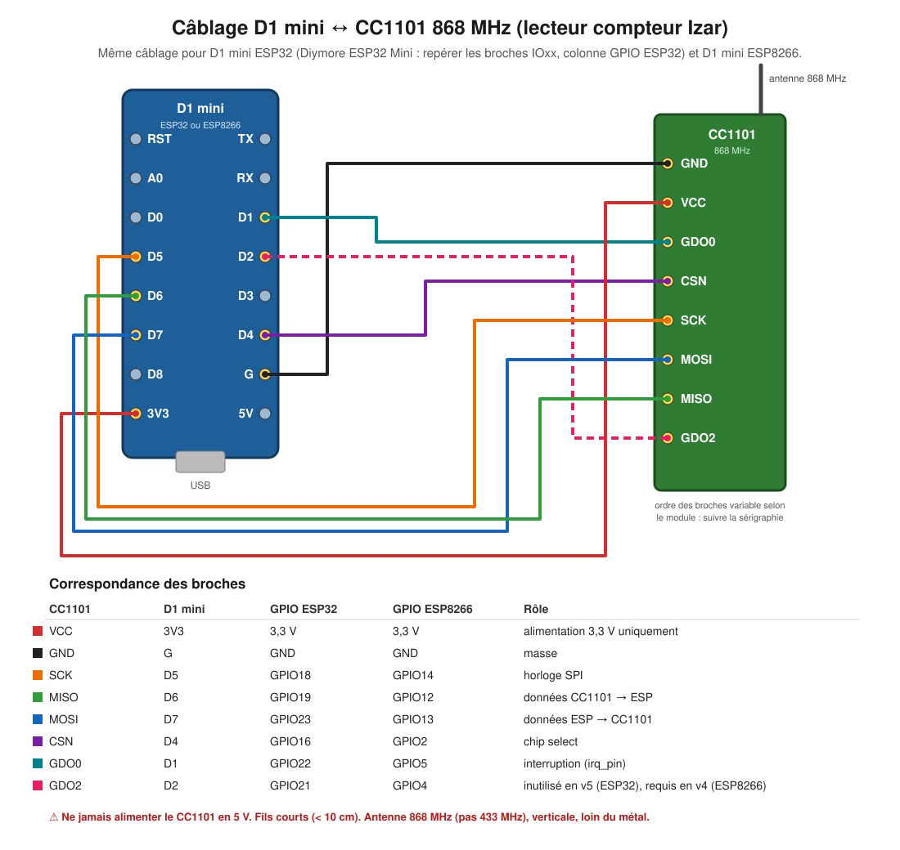

# Compteur d'eau Diehl IZAR → Home Assistant (ESPHome)

Firmware ESPHome qui lit par radio l'index d'un compteur d'eau **Diehl Altair + module IZAR RC** (wM-Bus T1, 868,95 MHz, protocole PRIOS) avec un **ESP32 D1 mini** et un module **CC1101 868 MHz**. Il s'appuie sur le composant [`SzczepanLeon/esphome-components`](https://github.com/SzczepanLeon/esphome-components) (driver `izar` de wmbusmeters). L'index remonte nativement dans Home Assistant en m³, prêt pour le tableau de bord Eau.


## Points forts

- **Aucune intervention sur le compteur** : on écoute simplement les trames radio que le module IZAR émet toutes les 8 à 32 s pour la télérelève.
- **Pas de clé à demander** dans la grande majorité des cas : le driver `izar` connaît les clés PRIOS par défaut de Diehl.
- **Index en m³ prêt pour le tableau de bord Eau** (`device_class: water`, `state_class: total_increasing`), plus l'index du mois précédent, les alarmes (fuite, blocage…) et l'autonomie de la pile du module radio.
- **Base HA ménagée** : l'index n'est publié que s'il change d'au moins 0,5 L, ou toutes les 5 min.
- **Un seul fichier à créer dans ESPHome** : 3 substitutions qui chargent ce dépôt à distance.
- **Seul le driver Izar est compilé** : firmware plus léger et compilation plus rapide.

## Matériel

- **Diymore ESP32 Mini** (ESP32-WROOM-32, USB CH9102F), ou tout « D1 mini ESP32 » / MH-ET LIVE MiniKit.
- **Module CC1101 868 MHz** avec son antenne. Attention : les modules les plus courants sont en 433 MHz.
- 8 fils Dupont courts.

Un D1 mini **ESP8266** fonctionne aussi, avec le même câblage, mais avec l'ancienne version du composant (voir [Variante ESP8266](#variante-esp8266)).

## Câblage



(version PNG : [`docs/schema-cablage-d1mini-cc1101.png`](docs/schema-cablage-d1mini-cc1101.png))

| CC1101 | D1 mini | GPIO ESP32 (sérigraphie Diymore) | GPIO ESP8266 | Rôle |
|---|---|---|---|---|
| VCC | 3V3 | 3V3 | 3V3 | alimentation **3,3 V uniquement** |
| GND | G | GND | GND | masse |
| SCK | D5 | IO18 | GPIO14 | horloge SPI |
| MISO (SO/GDO1) | D6 | IO19 | GPIO12 | données CC1101 → ESP |
| MOSI (SI) | D7 | IO23 | GPIO13 | données ESP → CC1101 |
| CSN | D4 | IO16 | GPIO2 | chip select |
| GDO0 | D1 | IO22 | GPIO5 | interruption (`irq_pin`) |
| GDO2 | D2 | IO21 | GPIO4 | inutilisé sur ESP32, requis sur ESP8266 |

Conseils :

- **Diymore ESP32 Mini** : la carte a deux rangées de broches de chaque côté et la sérigraphie indique `IOxx`, pas `D1`…`D8`. Repérez les broches avec la colonne « GPIO ESP32 ».
- **Jamais de 5 V sur le CC1101.**
- L'ordre des broches du CC1101 varie selon les modules : suivez la sérigraphie du vôtre.
- Fils courts (moins de 10 cm). Antenne verticale, éloignée du métal et de l'ESP. Placez le montage au plus près du compteur (regard, gaine technique) : la portée du module IZAR est de quelques dizaines de mètres.

## Installation

### 1. Les secrets

Dans le `secrets.yaml` de votre dossier ESPHome (voir [`exemples/secrets.yaml.exemple`](exemples/secrets.yaml.exemple)) :

```yaml
wifi-iot_ssid: "MonWifi"
wifi-iot_password: "motdepasse"
api_key: "..."   # openssl rand -base64 32
```

Les secrets restent chez vous : le dépôt ne fait que les référencer avec `!secret`. La même `api_key` chiffre l'API et les mises à jour OTA.

### 2. Le fichier de l'appareil

Dans ESPHome Device Builder, créer un appareil et remplacer son contenu par (voir [`exemples/compteur-eau.yaml`](exemples/compteur-eau.yaml)) :

```yaml
substitutions:
  name: compteur-eau            # nom réseau (minuscules, tirets)
  friendly_name: Compteur eau   # nom de l'appareil dans Home Assistant
  meter_id: "0x13903750"        # ID radio du compteur, à confirmer dans les logs

packages:
  compteur: github://sarus3749/esphome-compteur-eau-izar/compteur-eau-esp32.yaml@main
```

Avec `@main`, ESPHome rafraîchit la configuration au plus une fois par jour. Pour la figer, remplacez `main` par un tag ou un commit. Vous pouvez aussi copier directement [`compteur-eau-esp32.yaml`](compteur-eau-esp32.yaml) pour tout modifier.

### 3. Compiler et flasher

- **Première fois, au câble USB** : *Install* → *Plug into this computer*, ou *Manual download* puis [ESPHome Web](https://web.esphome.io). Sous Windows, installez le pilote **CH9102 (CH343)** si le port n'apparaît pas. Si le flash ne démarre pas, maintenez le bouton BOOT au moment de la connexion.
- **Ensuite** : *Install* → *Wirelessly*.

La première compilation est longue (téléchargement d'esp-idf et du composant).

### 4. Trouver l'ID du compteur

Le fichier part de `0x13903750` (le TxS/N imprimé sur le module), mais l'adresse radio réellement émise peut différer. Ouvrez les logs :

- compteur trouvé : ligne `Telegramme du compteur d'eau decode`, et l'index s'affiche ;
- sinon : `Telegram not handled by any handler` puis `Check if telegram with address XXXXXXXX can be parsed on: …`. Repérez l'adresse qui revient toutes les 8 à 32 s avec un bon RSSI, mettez-la dans `meter_id: "0xXXXXXXXX"` et réinstallez sans fil.

Chaque trame reçue (y compris celles des compteurs voisins) est aussi journalisée avec son RSSI. Une fois l'ID confirmé, vous pouvez retirer le bloc `on_frame` si vous utilisez une copie du fichier.

## Dans Home Assistant

| Entité | Catégorie | Rôle |
|---|---|---|
| Index eau | | Index total en m³ (`water`, `total_increasing`), source du tableau de bord Eau |
| Index fin du mois précédent | | Index mémorisé par le compteur à la date du relevé mensuel |
| Alarmes en cours | | `no_alarm`, `leakage`, `meter_blocked`, `underflow`… |
| Autonomie pile module radio | Diagnostic | En années |
| Période d'émission | Diagnostic | Intervalle entre deux trames, en s |
| Signal radio compteur | Diagnostic | RSSI du compteur, en dBm |
| Alarmes précédentes | Diagnostic | |
| Date du relevé mensuel | Diagnostic | |
| Signal WiFi, Uptime, Statut | Diagnostic | |
| Redémarrer | Diagnostic | |

**Tableau de bord Eau** : *Paramètres → Tableaux de bord → Énergie → Consommation d'eau → Ajouter une source* → `Index eau`. Les statistiques se remplissent à partir de l'heure suivante.

Une automatisation sur `Alarmes en cours` différent de `no_alarm` permet d'être prévenu d'une fuite.

## Clé AES

Les modules Diehl IZAR en mode PRIOS sont « brouillés » avec une clé que le driver `izar` connaît déjà (clés par défaut Diehl) : **dans la grande majorité des cas, aucune clé n'est nécessaire**.

Si les logs affichent `(izar) Decoding PRIOS data failed. Ignoring telegram.`, le distributeur (Veolia, Suez, Saur, régie…) a configuré une clé spécifique. Demandez-la-lui (16 octets en hexadécimal, 32 caractères), ajoutez `cle_compteur_eau` dans votre `secrets.yaml`, puis décommentez `key: !secret cle_compteur_eau` dans une copie de `compteur-eau-esp32.yaml`. Beaucoup refusent, mais la demande peut s'appuyer sur votre droit d'accès à vos données de consommation.

## Comment ça marche

1. Le CC1101 écoute en continu 868,95 MHz en mode T1 et signale chaque trame sur GDO0.
2. Le composant `wmbus_radio` décode le codage 3 parmi 6 et vérifie les CRC.
3. `wmbus_meter` ne garde que les trames dont l'adresse correspond à `meter_id` et les passe au driver `izar` de wmbusmeters, qui désembrouille le contenu PRIOS.
4. Chaque champ décodé (`total_m3`, `current_alarms`…) alimente un capteur ESPHome, envoyé à Home Assistant par l'API native.

## Variante ESP8266

La version actuelle du composant (v5, branche `main`) ne fonctionne **que sur ESP32 avec esp-idf**. Sur un D1 mini ESP8266, utilisez [`compteur-eau-esp8266.yaml`](compteur-eau-esp8266.yaml) en copie directe. Il repose sur l'ancienne v4 (branche `version_4`), qui n'évolue plus et dont la syntaxe est différente. Le câblage est le même, mais GDO2 y est obligatoire. Pour trouver l'ID, `log_all: True` affiche directement `izar [0xXXXXXXXX] RSSI: …`.

## Fichiers

| Fichier | Rôle |
|---|---|
| [`compteur-eau-esp32.yaml`](compteur-eau-esp32.yaml) | Configuration complète ESP32, chargée à distance par le fichier de l'appareil |
| [`compteur-eau-esp8266.yaml`](compteur-eau-esp8266.yaml) | Variante ESP8266 (composant v4), à copier telle quelle |
| [`exemples/compteur-eau.yaml`](exemples/compteur-eau.yaml) | Le fichier à créer dans ESPHome (3 substitutions) |
| [`exemples/secrets.yaml.exemple`](exemples/secrets.yaml.exemple) | Les clés à mettre dans votre `secrets.yaml` |
| [`docs/`](docs/) | Schéma de câblage (SVG + PNG) |

## État

- Syntaxe vérifiée sur `SzczepanLeon/esphome-components` (v5, commit `76dda80` du 22/11/2026, et branche `version_4`).
- Les configurations passent `esphome config` (ESPHome 2026.11.1).
- Compilation et réception pas encore testées sur le matériel.

## Licence

MIT
