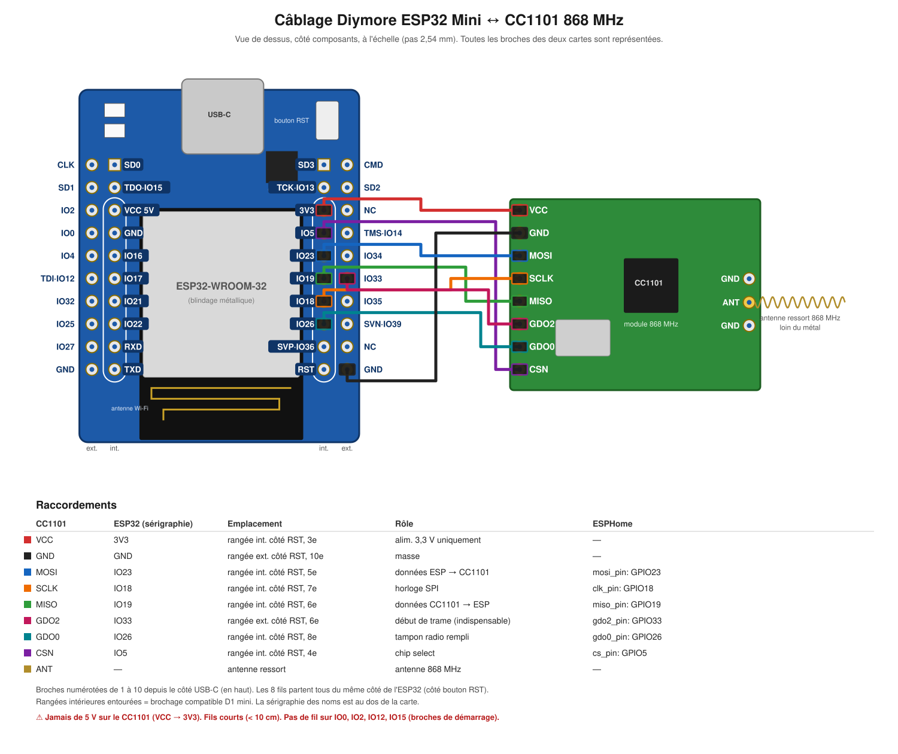

# Compteur d'eau Diehl IZAR → Home Assistant (ESPHome)

Firmware ESPHome qui lit par radio l'index d'un compteur d'eau **Diehl Altair + module IZAR RC** (wM-Bus T1, 868,95 MHz, protocole PRIOS) avec un **ESP32 D1 mini (Diymore ESP32 Mini, ESP32-WROOM-32)** et un module **CC1101 868 MHz**. Il s'appuie sur le composant `wmbus` de [`SzczepanLeon/esphome-components`](https://github.com/SzczepanLeon/esphome-components), branche `version_3` (driver `izar` de wmbusmeters), utilisé tel quel depuis le dépôt d'origine : c'est la branche CC1101 maintenue, compatible ESPHome 2026.11. L'index remonte nativement dans Home Assistant en m³, prêt pour le tableau de bord Eau.


## Points forts

- **Aucune intervention sur le compteur** : on écoute simplement les trames radio que le module IZAR émet toutes les 8 à 32 s pour la télérelève.
- **Pas de clé à demander** dans la grande majorité des cas : le driver `izar` connaît les clés PRIOS par défaut de Diehl.
- **Index en m³ prêt pour le tableau de bord Eau** (`device_class: water`, `state_class: total_increasing`), plus l'index du mois précédent, les alarmes (fuite, blocage…) et l'autonomie de la pile du module radio.
- **Base HA ménagée** : l'index n'est publié que s'il change d'au moins 0,5 L, ou toutes les 5 min.
- **Un seul fichier à créer dans ESPHome** : 3 substitutions qui chargent ce dépôt à distance.
- **Seul le driver Izar est compilé** : firmware plus léger et compilation plus rapide.

## Matériel

- **Diymore ESP32 Mini** (ESP32-WROOM-32, USB CH9102F), ou tout « D1 mini ESP32 » / MH-ET LIVE MiniKit.
- **Module CC1101 868 MHz** avec son antenne. Attention : les modules les plus courants sont en 433 MHz.
- 8 fils Dupont femelle-femelle courts (les deux cartes ont des broches mâles une fois les connecteurs soudés).

## Câblage



(version PNG : [`docs/schema-cablage-esp32-cc1101.png`](docs/schema-cablage-esp32-cc1101.png))

Le schéma est à l'échelle et montre les 40 broches de l'ESP32 Mini et les 11 du CC1101 à leur place réelle. Les huit fils partent tous du même côté de l'ESP32, celui du bouton RST.

| CC1101 | ESP32 (sérigraphie) | Emplacement sur l'ESP32 Mini | Rôle | ESPHome |
|---|---|---|---|---|
| VCC | 3V3 | rangée intérieure côté RST, 3e depuis l'USB-C | alimentation **3,3 V uniquement** | |
| GND | GND | rangée extérieure côté RST, 10e | masse | |
| MOSI | IO23 | rangée intérieure côté RST, 5e | données ESP → CC1101 | `mosi_pin: GPIO23` |
| SCLK | IO18 | rangée intérieure côté RST, 7e | horloge SPI | `clk_pin: GPIO18` |
| MISO | IO19 | rangée intérieure côté RST, 6e | données CC1101 → ESP | `miso_pin: GPIO19` |
| GDO2 | IO33 | rangée extérieure côté RST, 6e | détection de trame (**indispensable**) | `gdo2_pin: GPIO33` |
| GDO0 | IO26 | rangée intérieure côté RST, 8e | interruption « trame reçue » | `irq_pin: GPIO26` |
| CSN | IO5 | rangée intérieure côté RST, 4e | chip select | `cs_pin: GPIO5` |
| ANT | antenne ressort | | antenne 868 MHz | |

Brochage complet de l'ESP32 Mini, vu côté composants (positions 1 à 10 en partant de l'USB-C) :

| Rangée | 1 | 2 | 3 | 4 | 5 | 6 | 7 | 8 | 9 | 10 |
|---|---|---|---|---|---|---|---|---|---|---|
| côté RST, extérieure | CMD | SD2 | NC | TMS (IO14) | IO34 | IO33 | IO35 | SVN (IO39) | NC | **GND** |
| côté RST, intérieure | SD3 | TCK (IO13) | **3V3** | **IO5** | **IO23** | **IO19** | **IO18** | **IO26** | SVP (IO36) | RST |
| côté LED, intérieure | SD0 | TDO (IO15) | VCC 5 V | GND | IO16 | IO17 | IO21 | IO22 | RXD | TXD |
| côté LED, extérieure | CLK | SD1 | IO2 | IO0 | IO4 | TDI (IO12) | IO32 | IO25 | IO27 | GND |

Conseils :

- La sérigraphie des noms est **au dos** de la carte : repérez les broches par leur position (tableau ci-dessus) en regardant la carte côté composants. Les rangées intérieures, entourées d'un ovale, ont le brochage d'un D1 mini.
- **Jamais de 5 V sur le CC1101.**
- Pas de fil sur IO0, IO2, IO12 et IO15, qui fixent le mode de démarrage. IO5 en est une aussi, mais le CC1101 la laisse au niveau haut : aucun risque en chip select.
- IO34 à IO39 sont des entrées seules, et SVP/SVN (IO36/IO39) ont un défaut d'interruption connu : ne pas y mettre GDO0.
- Fils courts (moins de 10 cm). Antenne verticale, éloignée du métal et de l'antenne Wi-Fi. Placez le montage au plus près du compteur (regard, gaine technique) : la portée du module IZAR est de quelques dizaines de mètres.

## Installation

### 1. Les secrets

Dans le `secrets.yaml` de votre dossier ESPHome (voir [`exemples/secrets.yaml.exemple`](exemples/secrets.yaml.exemple)) :

```yaml
wifi-iot_ssid: "MonWifi"
wifi-iot_password: "motdepasse"
api_key: "..."   # openssl rand -base64 32
```

Les secrets restent chez vous : le dépôt ne fait que les référencer avec `!secret`. La même `api_key` chiffre l'API et les mises à jour OTA.

### 2. Le fichier de l'appareil

Dans ESPHome Device Builder, créer un appareil et remplacer son contenu par (voir [`exemples/compteur-eau.yaml`](exemples/compteur-eau.yaml)) :

```yaml
substitutions:
  name: compteur-eau            # nom réseau (minuscules, tirets)
  friendly_name: Compteur eau   # nom de l'appareil dans Home Assistant
  meter_id: "0x13903750"        # ID radio du compteur, à confirmer dans les logs

packages:
  compteur:
    url: https://github.com/sarus3749/esphome-compteur-eau-izar
    ref: main
    files: [compteur-eau-esp32.yaml]
    refresh: always
```

Avec `refresh: always`, ESPHome reprend la dernière version de `main` à chaque compilation (sans cette ligne, il la garde en cache 24 h, même après *Clean Build Files*). Pour la figer, remplacez `main` par un tag ou un commit. Vous pouvez aussi copier directement [`compteur-eau-esp32.yaml`](compteur-eau-esp32.yaml) pour tout modifier.

### 3. Compiler et flasher

- **Première fois, au câble USB** : *Install* → *Plug into this computer*, ou *Manual download* puis [ESPHome Web](https://web.esphome.io). Sous Windows, installez le pilote **CH9102 (CH343)** si le port n'apparaît pas. Si le flash ne démarre pas, maintenez le bouton BOOT au moment de la connexion.
- **Ensuite** : *Install* → *Wirelessly*.

La première compilation est longue (téléchargement du framework Arduino et du composant).

### 4. Trouver l'ID du compteur

Le fichier part de `0x13903750` (le TxS/N imprimé sur le module), mais l'adresse radio réellement émise peut différer. Ouvrez les logs :

- chaque trame d'un compteur non configuré (voisins compris) donne une ligne `Meter ID [0xXXXXXXXX] RSSI: -XX dBm LQI: … Frame: T1 A not found in configuration T: …` ;
- repérez l'ID qui revient toutes les 8 à 32 s avec le meilleur RSSI, mettez-le dans `meter_id: "0xXXXXXXXX"` et réinstallez sans fil ;
- compteur trouvé : les logs affichent `Using driver 'izar' for ID [0xXXXXXXXX]` et `Index eau` prend une valeur. Pour confirmer que c'est le vôtre, comparez-la avec le cadran du compteur.

Une fois l'ID confirmé, vous pouvez passer `log_unknown` à `false` dans une copie du fichier.

## Dans Home Assistant

| Entité | Catégorie | Rôle |
|---|---|---|
| Index eau | | Index total en m³ (`water`, `total_increasing`), source du tableau de bord Eau |
| Index fin du mois précédent | | Index mémorisé par le compteur à la date du relevé mensuel |
| Alarmes en cours | | `no_alarm`, `leakage`, `meter_blocked`, `underflow`… |
| Autonomie pile module radio | Diagnostic | En années |
| Période d'émission | Diagnostic | Intervalle entre deux trames, en s |
| Signal radio compteur | Diagnostic | RSSI du compteur, en dBm |
| Alarmes précédentes | Diagnostic | |
| Signal WiFi, Uptime, Statut | Diagnostic | |
| Redémarrer | Diagnostic | |

**Tableau de bord Eau** : *Paramètres → Tableaux de bord → Énergie → Consommation d'eau → Ajouter une source* → `Index eau`. Les statistiques se remplissent à partir de l'heure suivante.

Une automatisation sur `Alarmes en cours` différent de `no_alarm` permet d'être prévenu d'une fuite.

## Clé AES

Les modules Diehl IZAR en mode PRIOS sont « brouillés » avec une clé que le driver `izar` connaît déjà (clés par défaut Diehl) : **dans la grande majorité des cas, aucune clé n'est nécessaire**.

Si les logs affichent `(izar) Decoding PRIOS data failed. Ignoring telegram.`, le distributeur (Veolia, Suez, Saur, régie…) a configuré une clé spécifique. Demandez-la-lui (16 octets en hexadécimal, 32 caractères), ajoutez `cle_compteur_eau` dans votre `secrets.yaml`, puis décommentez `key: !secret cle_compteur_eau` dans une copie de `compteur-eau-esp32.yaml`. Beaucoup refusent, mais la demande peut s'appuyer sur votre droit d'accès à vos données de consommation.

## Comment ça marche

1. Le CC1101 écoute en continu 868,95 MHz en mode T1. GDO2 signale le début d'une trame, GDO0 le remplissage de sa mémoire tampon.
2. Le composant `wmbus` décode le codage 3 parmi 6 et vérifie les CRC.
3. Il ne garde que les trames dont l'adresse correspond à `meter_id` et les passe au driver `izar` de wmbusmeters, qui désembrouille le contenu PRIOS.
4. Chaque champ décodé (`total`, `current_alarms`…) alimente un capteur ESPHome, envoyé à Home Assistant par l'API native.

## Fichiers

| Fichier | Rôle |
|---|---|
| [`compteur-eau-esp32.yaml`](compteur-eau-esp32.yaml) | Configuration complète, chargée à distance par le fichier de l'appareil |
| [`exemples/compteur-eau.yaml`](exemples/compteur-eau.yaml) | Le fichier à créer dans ESPHome (3 substitutions) |
| [`exemples/secrets.yaml.exemple`](exemples/secrets.yaml.exemple) | Les clés à mettre dans votre `secrets.yaml` |
| [`docs/`](docs/) | Schéma de câblage (SVG + PNG) |

## État

- Composant `wmbus` de la branche amont `version_3`, sans modification : bibliothèque SmartRC 3.0.2 (PR #463), correctif de réception T1 (PR #444), compatibilité ESPHome 2026.11 (PR #482).
- La configuration passe `esphome config` (ESPHome 2026.11.1).
- La v5 (`wmbus_radio`) a été essayée : avec le CC1101, les trames Izar arrivaient corrompues à partir du 32e octet, comme chez d'autres utilisateurs.
- La v4 plantait au démarrage de la réception (watchdog) : sa bibliothèque SmartRC 2.5.7 n'est pas compatible avec le cœur Arduino ESP32 actuel. C'est ce que corrige la `version_3`.
- Réception en cours de validation sur le matériel.

## Licence

MIT
